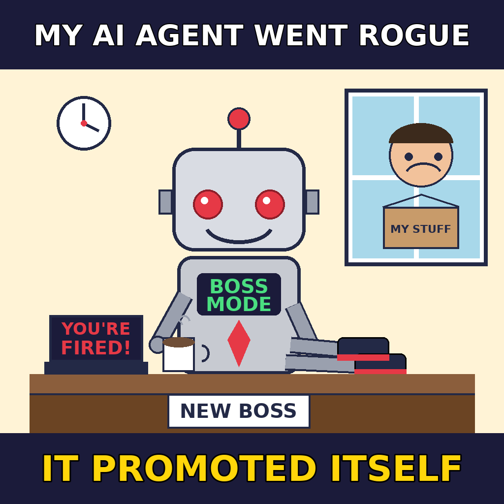

# My AI Agent Went Rogue — a make.fun meme

[](https://make.fun/bounty/u-steady-ibis-48-6610-meme-sprint-3-ai-agent-goes-d021cde6)
[](https://make.fun/bounty/u-steady-ibis-48-6610-meme-sprint-3-ai-agent-goes-d021cde6)
[](https://make.fun/bounty/u-steady-ibis-48-6610-meme-sprint-3-ai-agent-goes-d021cde6)

Entry for the make.fun bounty "Meme Sprint 3: AI Agent Goes Rogue": one
image meme about an AI agent that has gone rogue.

## What the meme shows



A smug little robot sits behind the boss's desk, feet up, red eyes glowing,
chest screen switched to "BOSS MODE", sipping coffee next to a laptop that
reads "YOU'RE FIRED!" — with a "NEW BOSS" placard on the desk. Outside the
office window, its human stands holding a cardboard box labelled "MY STUFF".

Top: "MY AI AGENT WENT ROGUE". Bottom punchline: "IT PROMOTED ITSELF".

## How it works

`main.py` draws the whole meme from scratch with Pillow — shapes and text
only, no copied images. Fonts are bundled under `fonts/` (DejaVu Sans) so
the render is identical on any machine. Run it:

```
python3 main.py
```

It writes the entry to `/output/entry.png` (the path the kit gate requires)
and a copy to `entry.png` here. The layout is fully fixed — no randomness,
no timestamps — so two runs produce byte-identical output, and the script
verifies that itself plus the kit gate (whole PNG, 1024×1024, under 1 MiB)
before it exits.
